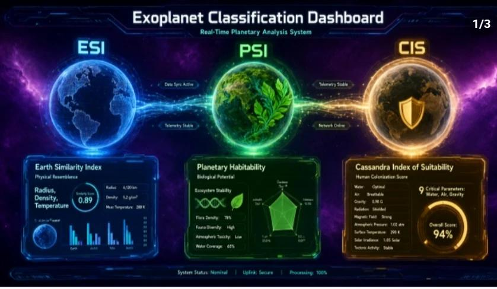

### 📊 Алгоритм и Методология: Индекс CIS

Стандартные научные индексы (такие как ESI или PHI) оказались недостаточно гибкими для задач моделирования в рамках этого проекта. Поэтому был разработан авторский Протокол априорной оценки (CIS — Cassandra Index of Suitability) — алгоритмическая модель, оценивающая пригодность экзопланет относительно земного эталона (100%). Модуль Cassandra Analysis Module анализирует 9 ключевых параметров с учетом их весовой значимости:

- 🌍 Базовые условия: Habitable Zone (15%), Surface (15%), Hydrosphere (20%)
- 🌬️ Среда: Atmosphere (10%), Breathability (5%), Climate (10%)
- ⚖️ Физика и защита: Gravity (5%), Magnetic Field (10%), Star Radiation (10%)
- 🛡️ Уникальная механика: Магнитный щит (Magnetic Shield)
  
В отличие от простого суммирования баллов, CIS учитывает динамическую защиту планеты. Напряженность магнитного поля активно фильтрует сырую звездную радиацию (блокируя до 80% от своего значения). Итоговый балл за радиацию рассчитывается как инверсия эффективной нагрузки, что делает оценку реалистичной и многомерной.

---

### ⚙️ Логика и валидация

Итоговый индекс (0–100%) вычисляется как взвешенная сумма: CIS = Σ (параметр_i × вес_i). Классификация планет происходит по строгим пороговым значениям (Thresholds), отсортированным по убыванию, что исключает ошибки граничных значений (off-by-one) при работе с дробными числами. Эта бизнес-логика не просто «отрисована» на фронтенде. Она является ядром для десятков сценариев автоматизированного тестирования (CAS), которые валидируют математическую точность расчетов, цветовую кодировку статусов и корректность управления состояниями интерфейса.

---

  

<i>Визуальное сравнение трёх подходов: ESI (физическое сходство), PHI (биологический потенциал) и CIS (инженерная пригодность для колонизации).</i>

### 📊 Сравнение индексов на примере Венеры:

- **Индекс ESI** 🌍 (Earth Similarity Index) оценивает физическое сходство планеты с Землёй по четырём базовым параметрам (радиус, плотность, скорость убегания, температура). Для Венеры он выдаёт около 44%, так как её размер и масса действительно близки к земным, но этот индекс не учитывает экстремальные условия на поверхности.

- **Индекс PHI** 🧬 (Planet Habitability Index) фокусируется на пригодности среды для естественной жизни, включая возможность существования экстремофилов. Его оценка для Венеры составляет около 18-20%, однако эта методология опирается на детальные данные о химическом составе, которые зачастую недоступны для отдалённых экзопланет.

- **Индекс CIS** 🚀 (Cassandra Index of Suitability) оценивает инженерную пригодность для колонизации. Для Венеры он выдаёт 16.5%, честно отражая реальную картину: гравитация близка к земной (90%), но критические провалы в атмосфере, гидросфере, климате и отсутствие магнитного поля делают планету непригодной для высадки.

- **Итог**: Для задач моделирования миссий в рамках Cassandra Framework индексы ESI и PHI не подходили. ESI оценивает сходство, а не пригодность, а PHI слишком теоретичен и зависит от недоступных данных. CIS был разработан как прагматичный инструмент для оценки технической колонизации с учётом реальных инженерных ограничений и взвешенных параметров.

---
