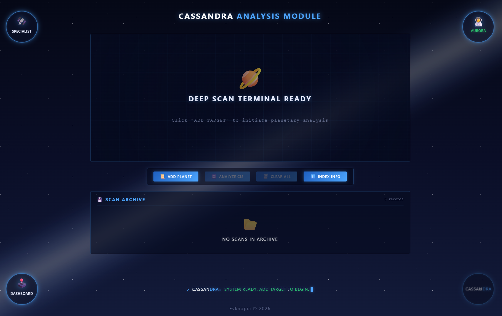
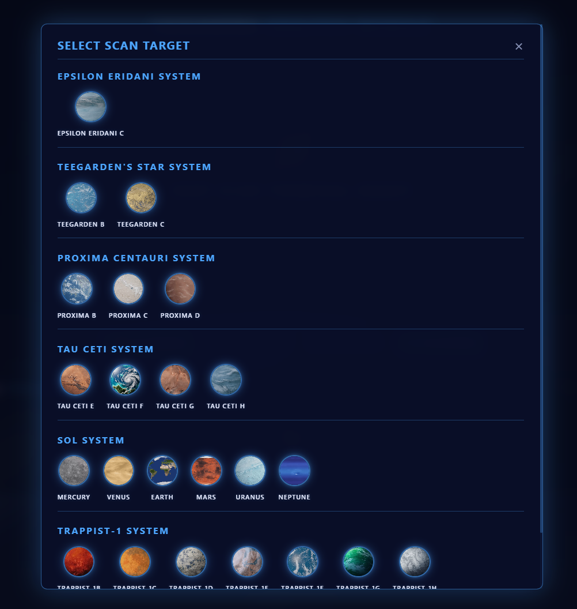
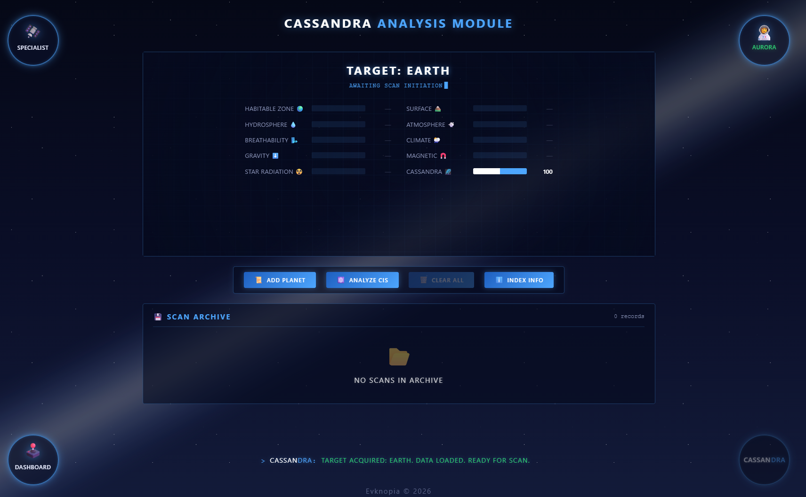
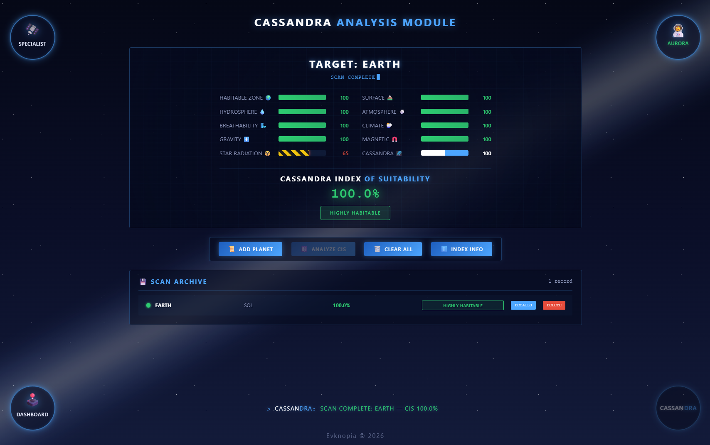
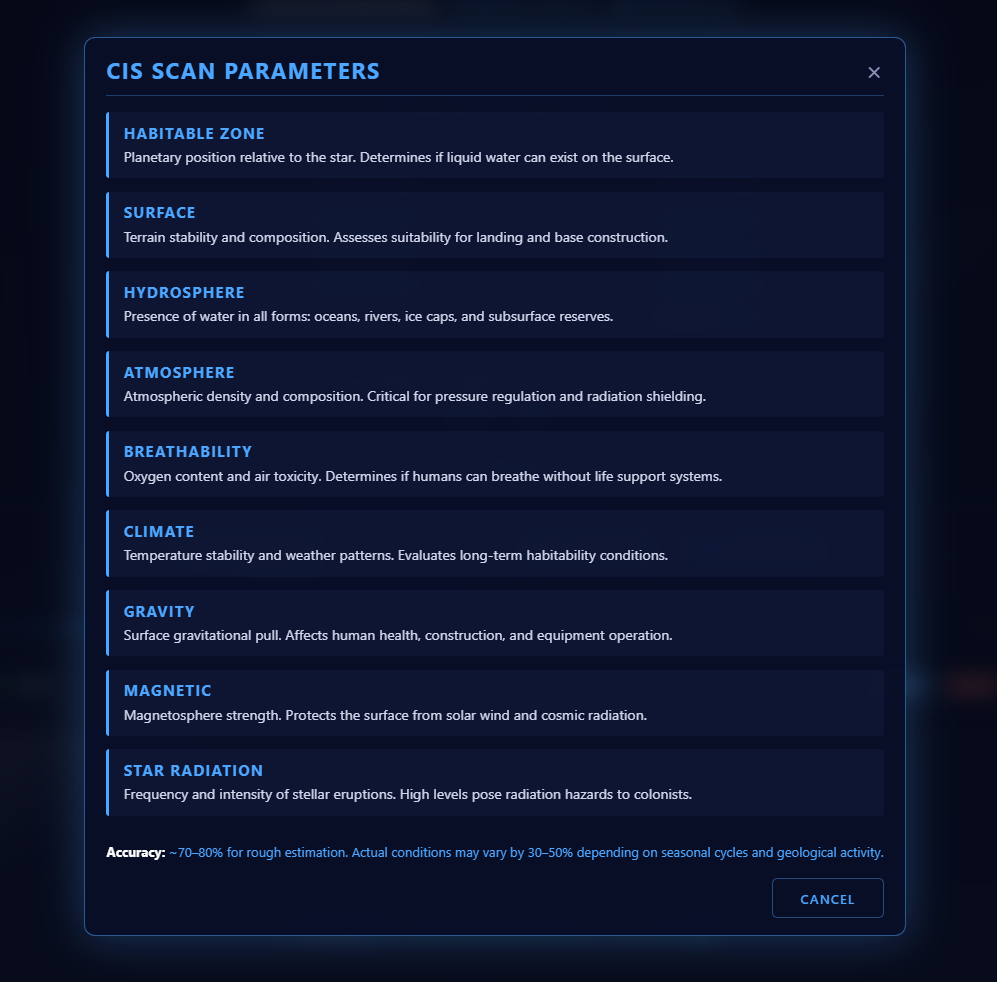
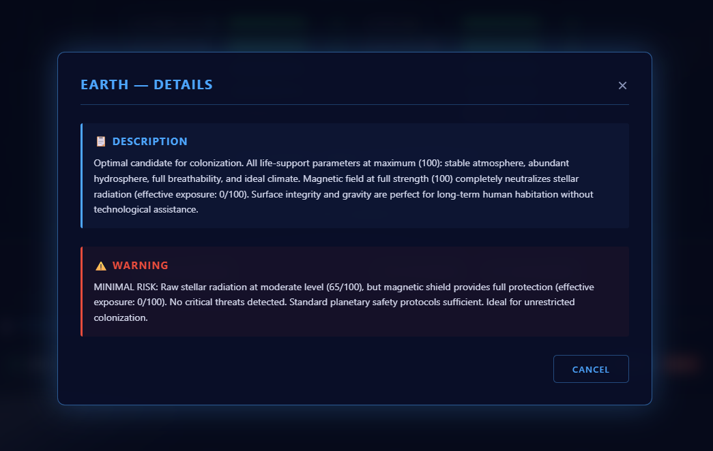
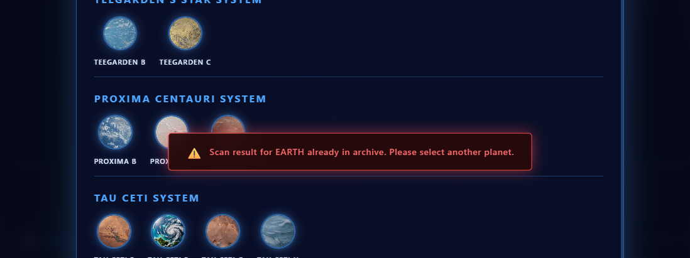

# CIS Index Table — Design & Mockups

## Overview
Интерактивный симулятор анализа пригодности экзопланет для колонизации в экосистеме Cassandra. Позволяет оператору выбирать целевые планеты, запускать глубокое сканирование и рассчитывать итоговый Индекс Пригодности (CIS) на основе 9 ключевых параметров. Включает авторскую механику магнитного щита для корректной оценки радиационной нагрузки, систему управления архивом с автоматической сортировкой и защитой от дубликатов, а также строгую валидацию граничных значений и состояний пользовательского интерфейса.

## Screenshots

### 1. Таблица расчета — Общий вид формы

### 2. Селектор выбора планет

### 3. Выбранная планета в таблице

### 4. Завершение сканирования

### 5. Модальное окно индекс инфо

### 6. Модальное окно удаления

### 7. Модальное окно детали

### 8. Ошибка планета уже отсканирована
