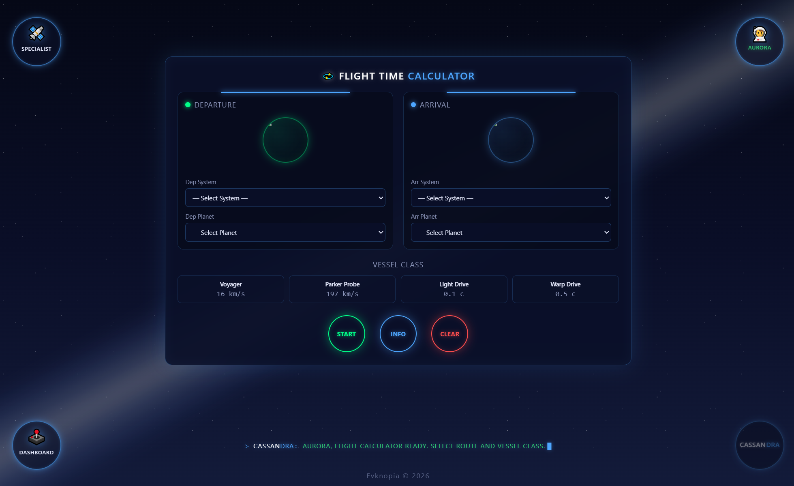
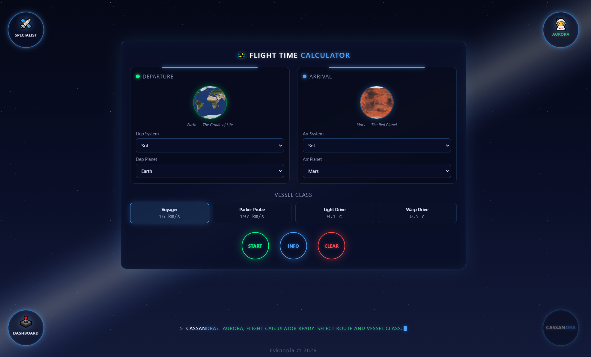
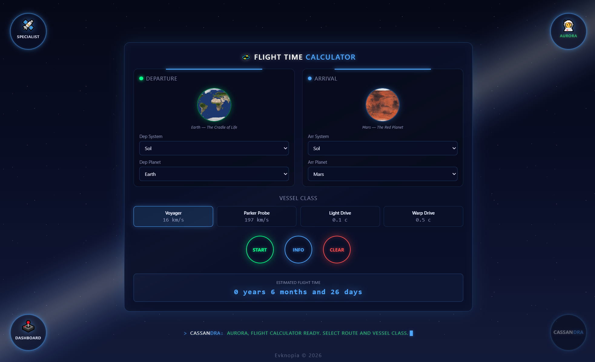
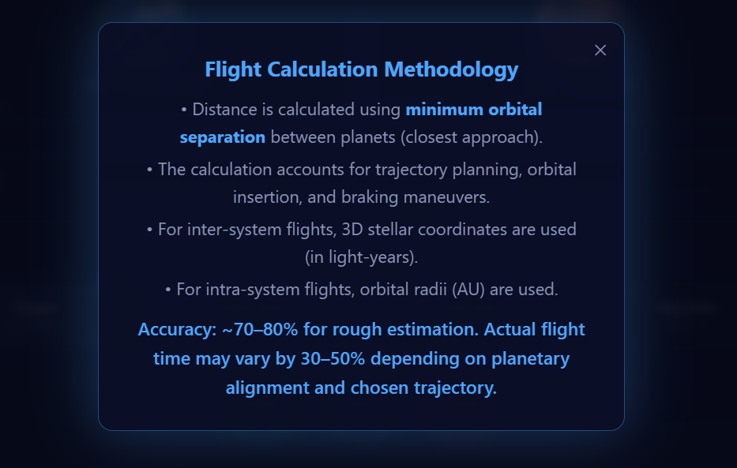
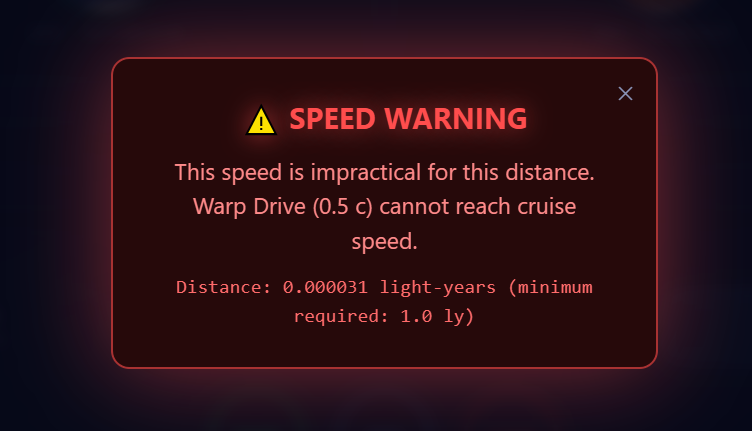

# Planet page — Design & Mockups

## Overview
Интерактивный модуль расчета времени межпланетных и межзвездных перелетов в системе Cassandra. Позволяет оператору выбирать точку отправления и прибытия (звездные системы, планеты, звезды), класс транспортного средства и получать оценку времени полета с учетом орбитальной механики, траекторных маневров и ограничений по скорости. Включает систему валидаций, предупреждений о нереалистичных скоростях и визуализацию процесса расчета.

## Screenshots

### 1. Калькулятор полетов — Общий вид формы

### 2. Выбор систем, планет, корабля

### 3. Выдача результатов

### 4. Информационное модальное окно 

### 5. Модальное окно предупреждения о скорости

### 6. Модальное окно заполнения систем

### 6. Модальное окно заполнения планет
