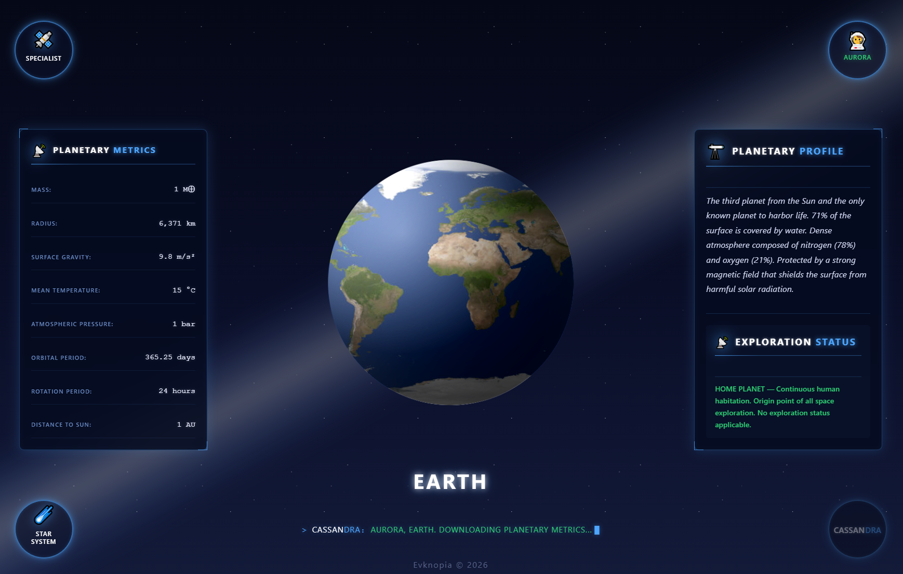
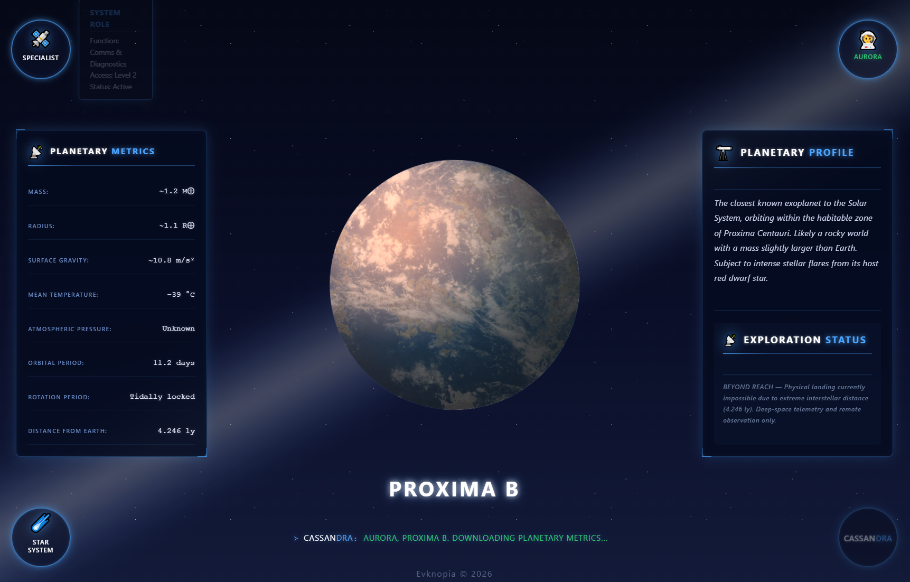
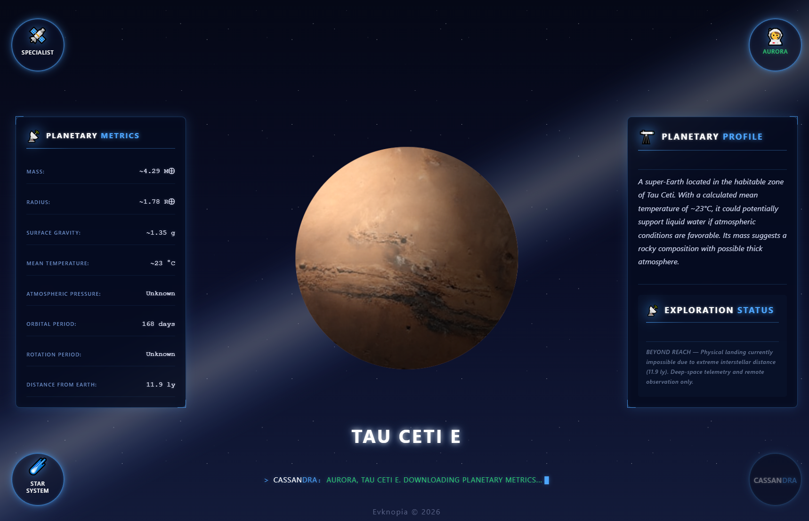
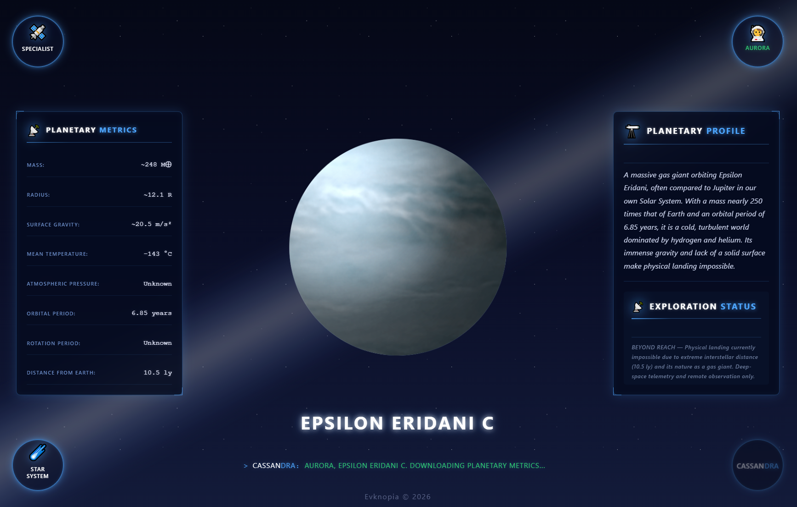
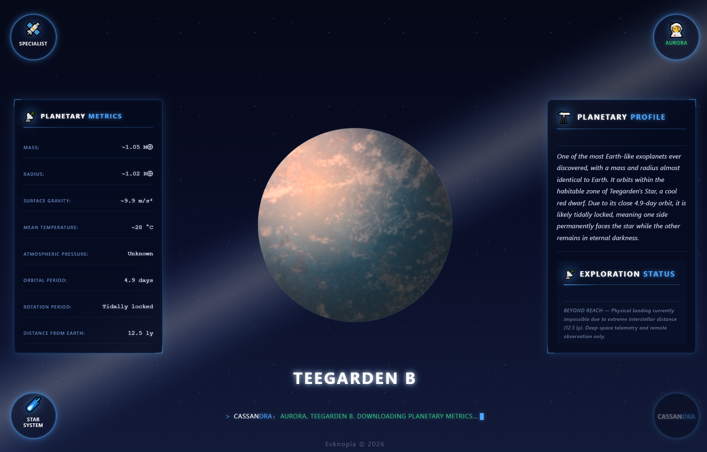
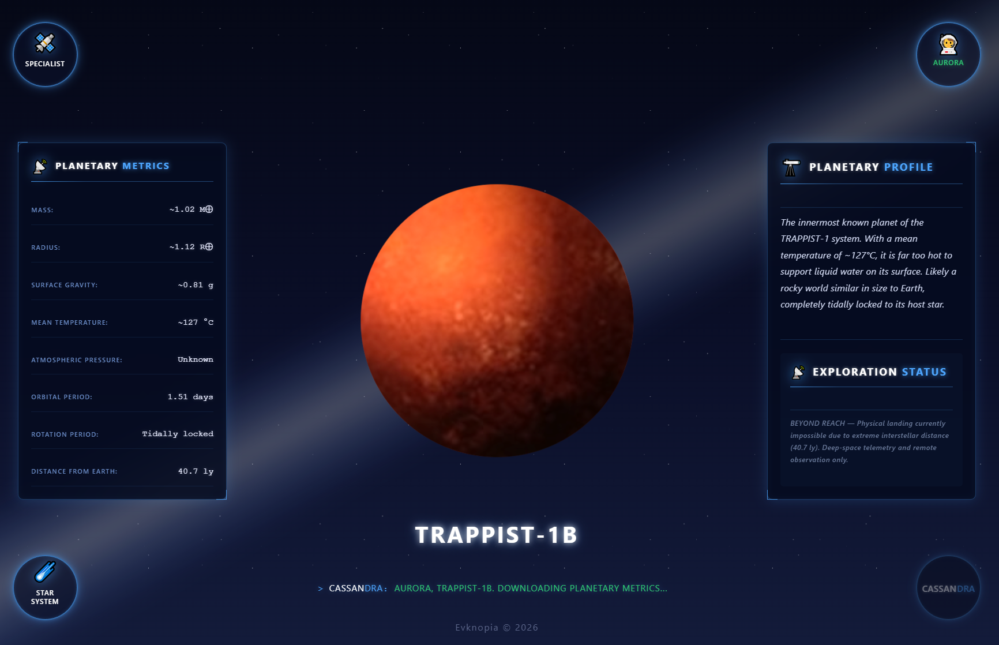

# Planet page — Design & Mockups

## Overview
Детальная информационная карточка выбранной планеты в пространстве Cassandra. Позволяет оператору изучать визуальную модель планеты, анализировать её физические метрики в левой панели (масса, радиус, гравитация, температура, атмосферное давление, орбитальный и вращательный периоды, расстояние), а также читать подробное описание и статус разведки в правой панели. Включает отображение системной телеметрии и навигационный переход обратно к звёздной системе.

## Screenshots

### 1. Солнечная система — Планета Земля, общий вид формы

### 2. Альфа Центавра А - Планета Проксима Б, общий вид формы

### 3. Тау Кита - Планета Тау Кита Е, общий вид формы

### 4. Эпсилон Эридана - Планета Эпсилон Эридана Ц, общий вид формы 

### 5. Звезда Тигардена - Планета Тигардена Б, общий вид формы

### 6. Траппист-1 - Планета Траппист-1Б, общий вид формы

